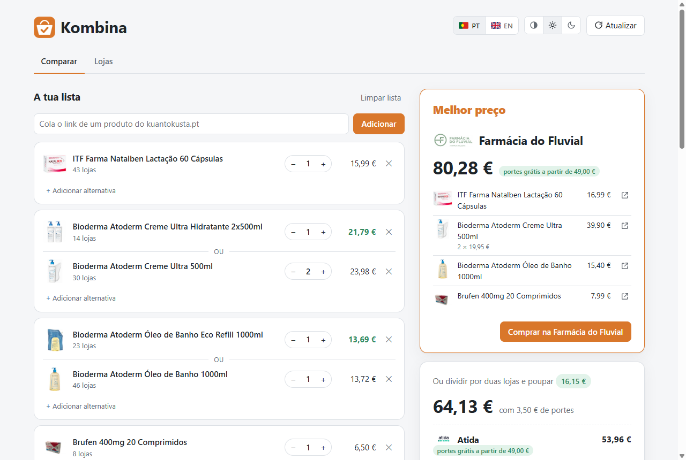
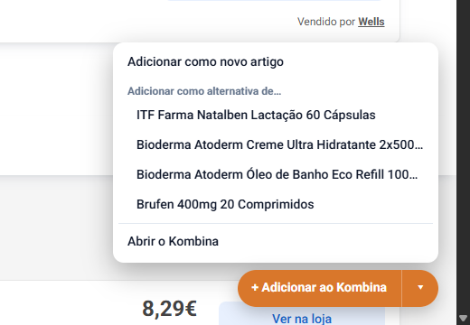
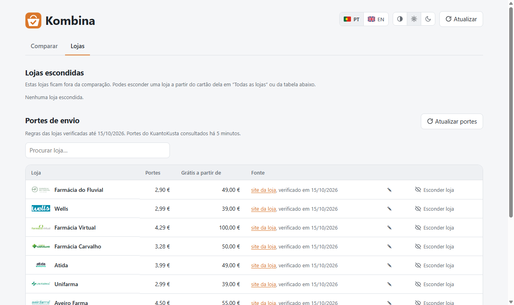

# Kombina

A Firefox and Chrome extension for [kuantokusta.pt](https://www.kuantokusta.pt) that takes the
list of products you want to buy and tells you which single store sells the whole list for
the least money, shipping included.



## Features

- Add products to your list straight from any kuantokusta.pt product page, or by pasting
  their links.
- See the cheapest store for the whole list, with each product's price, the shipping, and
  how much more you'd need to add for free shipping.
- When no store has everything, or when splitting is cheaper, get the best split between
  two stores and how much it saves.
- Give an item alternatives (a refill or the full bottle, a 2-pack or two singles): each
  store is priced with whichever alternative is cheapest there.
- Open every product at the chosen store in one click, through KuantoKusta's own
  "Ver na loja" links.
- Hide stores you never want to buy from, and correct any store's shipping cost or
  free-shipping threshold.
- Portuguese (Portugal) by default, with an English switch; light and dark themes.

## Install

Kombina isn't on the browser stores yet, so it's loaded from this folder. First clone the
repository, or download it as a ZIP from GitHub and unzip it.

**Firefox (121 or newer)**

1. Open `about:debugging#/runtime/this-firefox`.
2. Click **Load Temporary Add-on…** and choose `manifest.json` in the folder.
3. Click the Kombina icon in the toolbar. If the page asks for access to kuantokusta.pt,
   click **Permitir**.

Firefox removes temporary add-ons when it restarts. To keep it installed, sign it as an
unlisted add-on on [addons.mozilla.org](https://addons.mozilla.org/developers/)
(`npm run build` creates the zip).

**Chrome, Edge, Brave**

1. Open `chrome://extensions` and turn on **Developer mode**.
2. Click **Load unpacked** and choose the folder.

## How to use it

1. Open a product on kuantokusta.pt and click **+ Adicionar ao Kombina** (bottom right).
   The ▾ menu next to it adds the product as an alternative to something already on the
   list.

   

2. Click the Kombina icon in the toolbar to open your list. The right column shows the
   cheapest store; **Comprar na …** opens all the products there, one tab each.
3. Use the steppers to change quantities, and **+ Adicionar alternativa** to add a product
   that could replace one on the list.

## Shipping data

KuantoKusta shows the shipping cost of each offer but never the order value from which a
store ships free, which often decides the cheapest store. Kombina combines, in this order:

1. **Your corrections**, made with ✎ on any store.
2. **[`data/stores.json`](data/stores.json)**: the shipping cost and free-shipping threshold
   of the pharmacies that appear most on KuantoKusta, read from each store's own site, with
   the source page and the date it was checked.
3. **What the offers reveal**: a store that charges shipping on a cheap product but not on
   a pricier one has its threshold somewhere in between.



Store rules change. If one is wrong, edit `data/stores.json` and open a pull request, or open
an issue with the store page that shows the right value. Rules not checked for 90 days are
tagged *a verificar* in the extension, and a monthly GitHub Action
([`stale-stores.yml`](.github/workflows/stale-stores.yml)) opens an issue listing them.
Support for islands, pickup points and in-store pickup is planned in
[`docs/portes-de-envio.md`](docs/portes-de-envio.md).

## Development

There's no build step: the extension runs from the source files as they are.

```bash
npm install            # web-ext, for lint/run/build
npm test               # unit tests for the page parser and the optimizer
npm run lint           # web-ext lint
npm run start:firefox  # a temporary Firefox profile with the extension loaded
npm run start:chrome
npm run build          # zip in web-ext-artifacts/
npm run stale          # stores whose shipping rules are older than 90 days
```

| Path | What it does |
| --- | --- |
| `src/lib/kk.js` | Everything that depends on KuantoKusta's page structure (it reads `__NEXT_DATA__` from product pages). If the site changes, the fix goes here. |
| `src/lib/optimize.js` | Pure functions: shipping rules, best alternative per store, store ranking, 2-store splits. |
| `src/lib/storage.js` | The list, shipping corrections, hidden stores, and cached offers. |
| `src/app/` | The Kombina page. |
| `src/content/` | The button and menu on kuantokusta.pt product pages. |
| `src/shared/i18n.js` | Portuguese and English strings for the page (`src/content/strings.js` for the button). |
| `data/stores.json` | Shipping rules per store. Set `GITHUB_REPO` in `src/lib/config.js` and installed copies refresh it from GitHub once a day. |

## Limits

- It only works in a normal browser session: KuantoKusta's bot protection blocks scripts and
  headless browsers, which is why this is an extension.
- Shipping is for standard home delivery to mainland Portugal. Weight, islands and payment
  method can change it, so check the total at the store's checkout.
- The 2-store split gives each product to whichever of the two stores is cheaper for it; it
  doesn't move products around to reach a free-shipping threshold.

Kombina is an independent project, not affiliated with KuantoKusta or any of the stores.

## License

[MIT](LICENSE)
